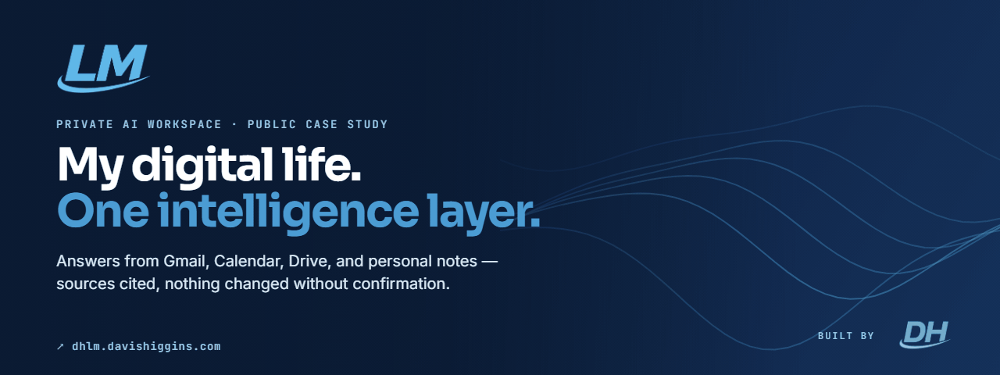
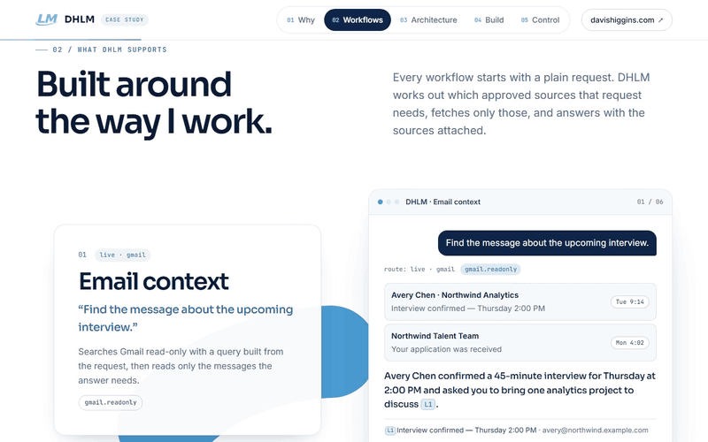
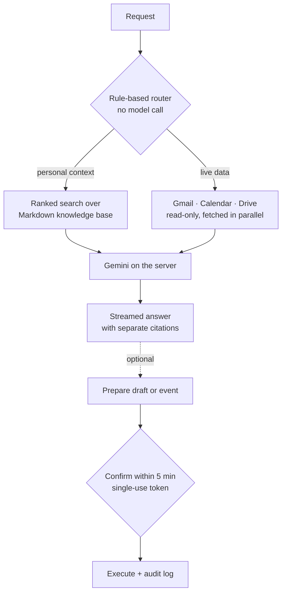
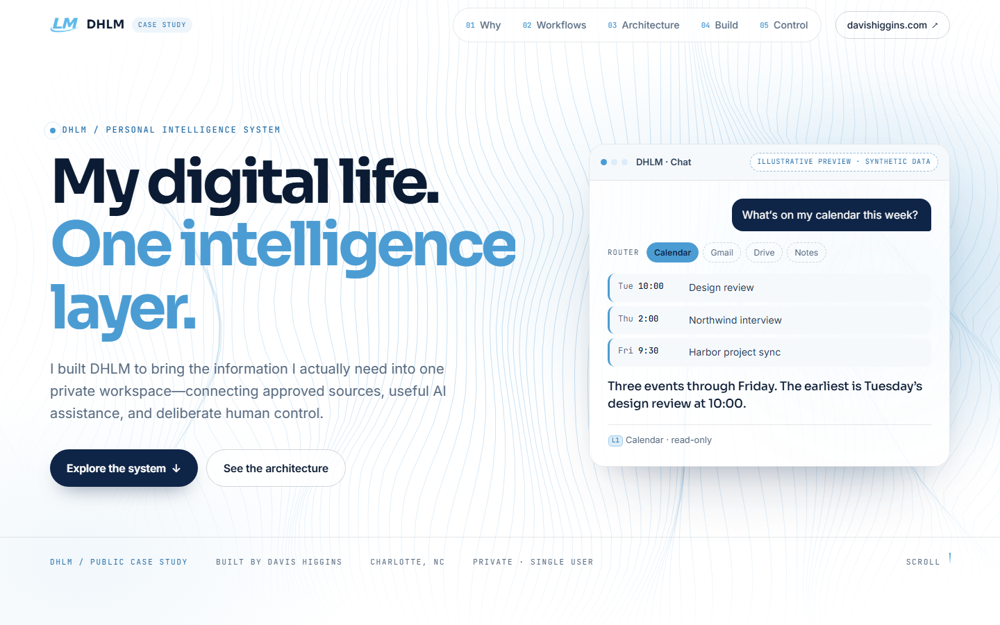
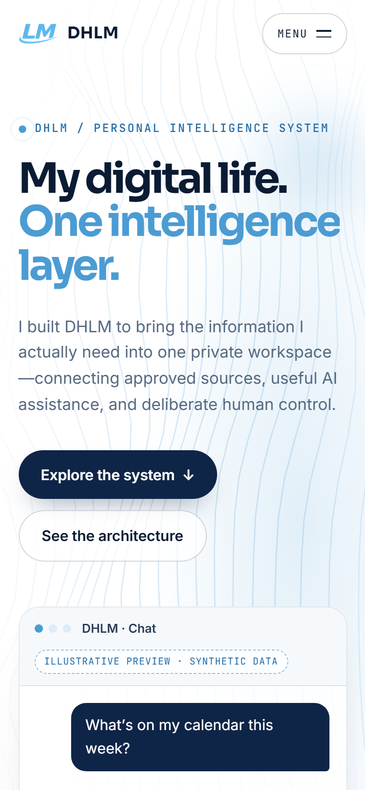
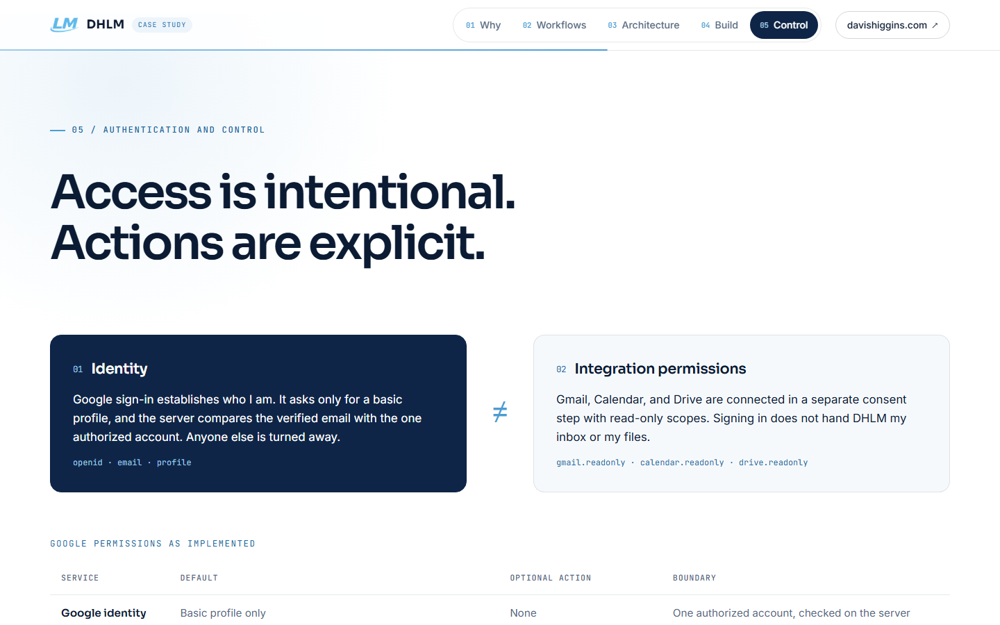

  

<h1 align="center">DHLM</h1>

  <strong>A private AI workspace that answers from Gmail, Calendar, Drive, and my personal notes, with sources cited and every change confirmed.</strong> 
  <a href="https://dhlm.davishiggins.com"><strong>Read the case study ↗</strong></a> · <a href="https://www.higginsd.com/work/dhlm">Studio write-up</a> · <a href="https://davishiggins.com">Davis Higgins</a>

Public case study, private application · Single user, no public sign-up · Designed and built by Davis Higgins

> **Public vs. private.** dhlm.davishiggins.com is a public case study built entirely on synthetic data. The application itself sits behind Google sign-in for one authorized account. Nothing in this repository, including every image, comes from my real inbox, calendar, or files.

---

## See it in motion

  

Real capture of the public case study's workflow section. Every preview is labeled synthetic. <a href="assets/demo.png">Static frame</a>

## What it does

- **One question, the right sources.** Ask about the week and DHLM decides whether it needs notes, Gmail, Calendar, or Drive, fetches only those, and streams an answer with knowledge and live-data citations kept visually separate.
- **Drafts, never sends.** It can prepare a Gmail draft or a Calendar event, show a preview, and act only after I confirm. Sending email stays manual.
- **Memory I approve.** When a conversation surfaces something worth remembering, DHLM proposes the update to my Markdown knowledge base and writes it only after I say yes.

## Why I built it

The context behind a decision is usually split three ways. One email holds a detail, a calendar event holds the time, and a document holds the rest. Answering a simple question about my week meant opening three apps and stitching the answer together by hand.

Handing a general AI assistant full access to all of it would swap a searching problem for a trust problem: no clear limit on what it reads, and no clear record of what it changed. So I built one private workspace that fetches only what a question needs, cites it, and changes nothing without confirmation.

## What I built

I designed and built DHLM end to end:

- The chat and command workspace, with streamed answers and citations beside each response
- A deterministic request router that picks sources before any model is called
- Google integrations for Gmail search, upcoming Calendar events, and Drive Docs, Sheets, Slides, and text files
- Two-step draft and event creation, approval-gated memory updates, and an audit log
- A career workspace for job discovery, application tracking, and labeling recruiter email
- The public case study, with synthetic previews of six workflows, the request architecture, and the access model

## How a request flows

### Engineering decisions

| Decision | Why |
|---|---|
| **Route before calling a model** | A rule-based router decides which sources a request needs. Generic questions skip personal retrieval entirely, and live data is fetched once, in parallel, with read-only access. That keeps cost predictable and limits what any single answer can see. |
| **Identity and data access are separate consents** | Sign-in asks only for a basic profile, and the server checks the email against one authorized account. Gmail, Calendar, and Drive are connected in a separate, read-only consent step. Draft and event permissions are optional, separately granted, and off by default. |
| **Every write is bound to what I reviewed** | A prepared draft or event gets a five-minute, single-use confirmation token tied to its exact details. If anything changes after review, the action is refused. Prepared and executed writes are both recorded in an audit log. |

The Google refresh token is sealed with AES-256-GCM in an HTTP-only cookie rather than stored in the database. Gemini runs only on the server, with a fast default model and a deeper one used on request within a daily budget.

## Screens

<table>
  <tr>
    <td width="62%"></td>
    <td rowspan="2" width="38%" align="center"></td>
  </tr>
  <tr>
    <td></td>
  </tr>
</table>

Case study hero (synthetic preview) · Authentication and control · Case study on mobile

## Technology

| Layer | Technology | Responsibility |
|---|---|---|
| App and case study | Next.js 16, React 19, TypeScript | Workspace, routing, streaming UI, public case study |
| AI | Gemini API (server-side) | Answers, with a budgeted deeper mode |
| Integrations | Google Workspace APIs (Gmail, Calendar, Drive) | Live context; optional drafts and events |
| Data | Supabase | Application records and the audit log |
| Motion | GSAP, Lenis | Case-study scroll scenes |
| Hosting | Vercel | Deployment |

## Status and limits

- **Not a public product.** There's no sign-up. The case study shares no interface, data, or links with the private application.
- **Briefs on request.** The morning brief runs when I ask for it. The only scheduled job handles job discovery and data retention, and it never touches Gmail or Calendar.
- **Drafts only.** The optional draft permission lets DHLM create Gmail drafts. It has no send action, so every email is sent by hand.

## About this repository

This is a documentation-only showcase. The application's source, prompts, knowledge base, configuration, and any real account data are private and aren't included here.

**[Read the case study ↗](https://dhlm.davishiggins.com)** · Built by [Davis Higgins](https://davishiggins.com) · [More of my work](https://github.com/DavisHiggins)

© 2026 Davis Higgins. Text and images in this repository are shared for portfolio viewing. The DHLM, LM, and DH marks belong to Davis Higgins. Gmail, Google Calendar, Google Drive, and Gemini are trademarks of Google LLC; DHLM is not affiliated with Google.
