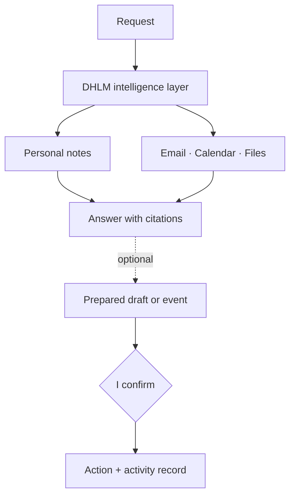

  

<h1 align="center">DHLM</h1>

<strong>A private AI workspace that answers from my email, calendar, files, and personal notes, with sources cited and every change confirmed.</strong>

  &nbsp;
  &nbsp;
  

Private application · Public case study with synthetic data · Designed and built by Davis Higgins

---

## See it in motion

  

Real capture of the public case study's workflow section. Every preview uses synthetic data. <a href="assets/demo.png">Static frame</a>

## What it does

- **One question, the right sources.** Ask about the week and DHLM works out which of my notes, email, calendar, or files it needs, then answers with every source cited.
- **Drafts, never sends.** It can prepare an email draft or a calendar event, show a preview, and act only after I confirm.
- **Memory I approve.** When a conversation surfaces something worth remembering, DHLM proposes the update and saves it only after I say yes.

## Why I built it

The context behind a decision is usually split three ways. One email holds a detail, a calendar event holds the time, and a document holds the rest. Answering a simple question about my week meant opening three apps and stitching the answer together by hand.

Handing a general assistant full access to all of it would trade a searching problem for a trust problem. So I built one private workspace that reads only what a question needs, cites it, and changes nothing without confirmation.

## What I built

I designed and built DHLM end to end:

- The chat and command workspace, with streamed answers and citations beside every response
- The intelligence layer that decides which sources a request needs
- Integrations with my email, calendar, and files
- Confirmed drafts and events, approval-gated memory, and a full activity record
- A career workspace for job discovery and application tracking
- The public case study, with synthetic previews of six workflows

<strong>How it's put together</strong>

 

| Decision | Why |
|---|---|
| **Only what the question needs** | Each request reaches only the sources it actually requires, which keeps answers focused and limits what any single answer can see. |
| **Access is deliberate** | Signing in and connecting data are separate steps, and anything beyond reading is opt-in. |
| **Every action is confirmed** | Nothing is sent, scheduled, or remembered until I've reviewed exactly what will happen, and every action is recorded. |

## Screens

<table>
  <tr>
    <td width="62%"></td>
    <td rowspan="2" width="38%" align="center"></td>
  </tr>
  <tr>
    <td></td>
  </tr>
</table>

Case study hero (synthetic preview) · Access and control · Case study on mobile

## Technology

| Layer | Technology |
|---|---|
| App and case study | Next.js, React, TypeScript |
| Data | Supabase |
| Motion | GSAP, Lenis |
| Hosting | Vercel |

---

  &nbsp;
  

© 2026 Davis Higgins. All rights reserved. The DHLM, LM, and DH marks belong to Davis Higgins.

